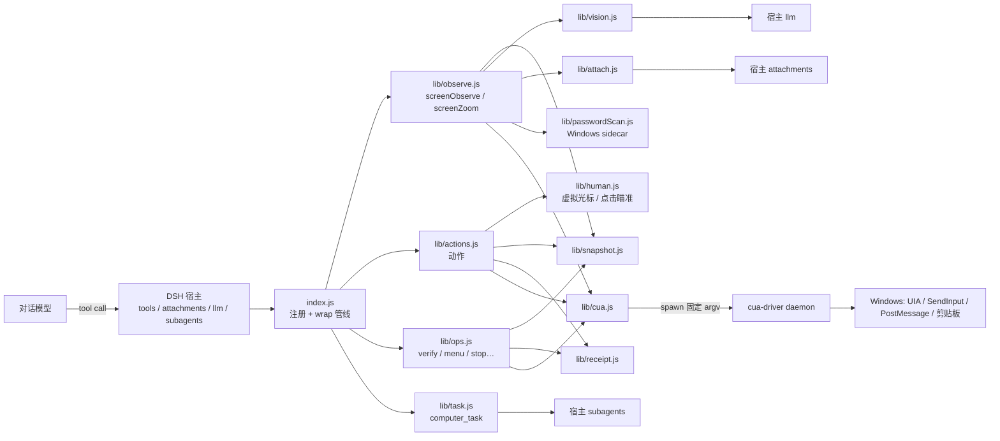
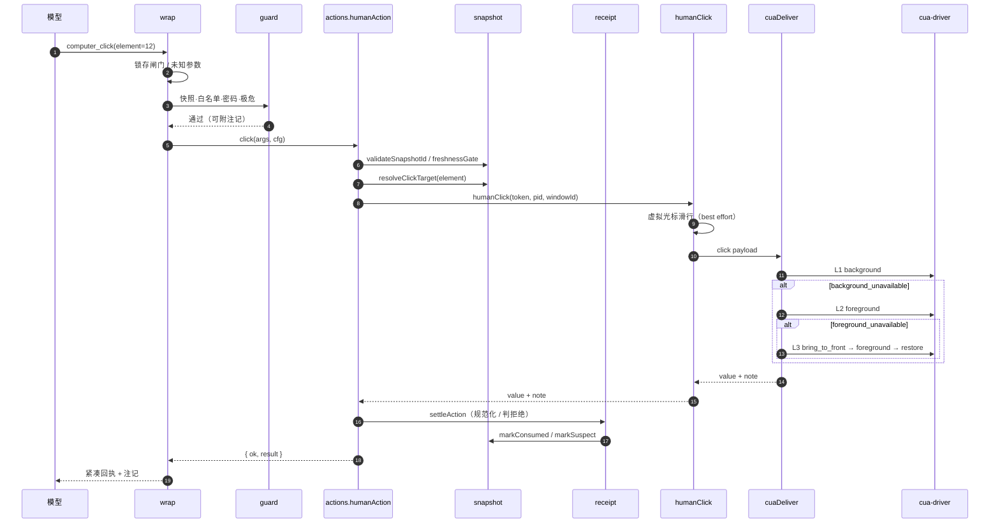
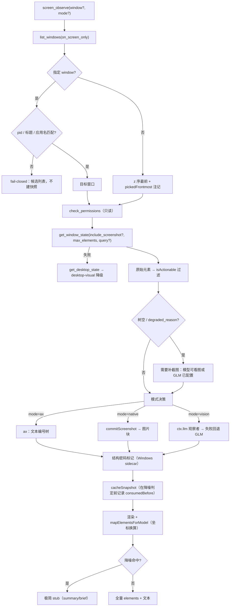
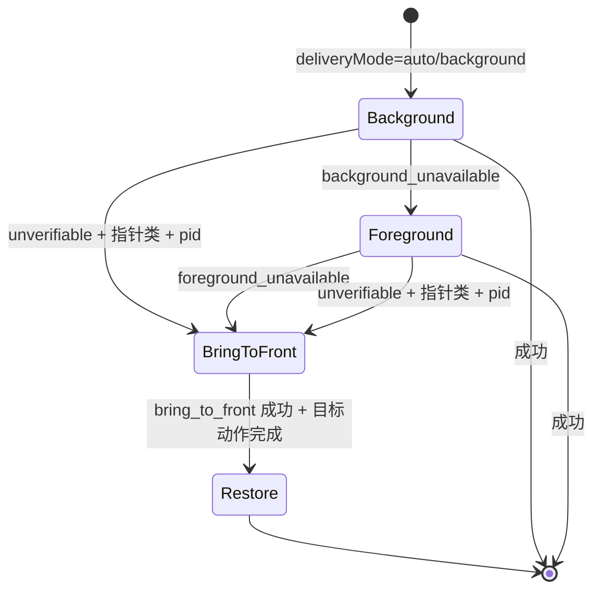

# ARCHITECTURE — dsh-win-computer-use

> 代码快照：`main` @ 2026-11-10（`0.5.7-dev`；包版本仍为 0.5.6，发布时统一）。
> 范围：插件内部结构、工具面、请求/观察流水线、投递链、快照语义、扩展方式。
> 读者：要改代码或排查行为的人。使用说明见 [README](../README.md)；Windows 专项见 [WINDOWS](WINDOWS.md)。

## 1. 目标与非目标

**目标**

1. 把桌面操作拆成模型可组合的细粒度工具，而不是一个黑盒“computer use”循环。
2. 每次动作都基于**可验证的观察快照**；失败、拒绝、未验证必须有结构化语义。
3. Windows 上把前台锁、UIPI、XAML/WinUI 输入、坐标/DPI 这些硬问题在插件层处理掉。
4. 工具列表在会话内稳定，避免工具层变化打断 prompt cache。

**非目标**

- 不做跨平台行为对齐；Windows 是深度实测目标，macOS 基础可用，Linux 未验证。
- 不做审批网关；安全姿态是“零审批 + 基本兜底 + 全量注记”。
- 不做动态工具面（enter/exit 已删除）；只保留 `dispatcher` / `hybrid` 两种稳定面。
- 不替代宿主的子 agent 沙箱；委派约束受宿主能力限制，插件如实报告降级。

## 2. 运行时拓扑



依赖方向是单向的：`index.js → lib/* → cua-driver`；`snapshot.js`、`attach.js`、`engine.js`、`roles.js`、`dispatcher.js` 是低层叶子，不反向依赖动作/观察模块。

## 3. 模块地图

| 文件 | 关键导出 | 职责 | 依赖 |
|---|---|---|---|
| `index.js` | `Config`、`apply`、`toolDefinitions` | 配置 schema；四组工具定义数组；`defineTool` 投影；`apply()` 注册可见工具；`wrap()` 统一管线；`computer_do` 元工具 | 全部 lib |
| `lib/observe.js` | `screenObserve`、`screenZoom`、`dedupEvaluate`、`dedupReset` | 目标选择、抓树、桌面降级、模式决策、结构密码标记、状态差分、快照缓存、渲染、降噪、zoom 裁剪 | cua / snapshot / attach / vision / passwordScan / roles |
| `lib/actions.js` | `click`、`doubleClick`、`rightClick`、`typeText`、`setValue`、`key`、`scroll`、`drag`、`wait`、`listApps`、`launchApp` | 动作实现；快照/窗口解析；目标回显；投递；回执 | cua / human / receipt / snapshot / engine |
| `lib/human.js` | `glideCursor`、`humanClick`、`resolveClickTarget`、`screenPointOf`、`windowLocalOf`、`describeClickTarget`、`nearestEntry` | 虚拟光标滑行（auto/human/off）；element_token / 像素点击；坐标适配；目标回显 | cua / snapshot |
| `lib/loopGuard.js` | `checkRepeat`、`noteObserveChange`、`resetLoopGuard` | 同窗口/目标/投递模式 5s 重复点击抑制；观察变化清除 | human |
| `lib/trajectory.js` | `trajectoryStart`、`runTool`、`logDriverCall`、`trajectorySummary`、`sanitizeArgs` | CU 轨迹 JSONL：脱敏、驱动归属、loop/耗时/未验证/移动数 | node:fs / node:async_hooks |
| `lib/ops.js` | `createOpsState`、`gate`、`stop`、`resume`、`verifyOnce`、`waitFor`、`clipboard`、`menu`、`hover` | 确定性验证、轮询、剪贴板、菜单直调、悬停、强杀锁存 | cua / snapshot / attach / engine / receipt |
| `lib/task.js` | `runComputerTask`、`resetTaskCalls`、`DELEGATION_RECIPE` | 子 agent 委派（0.2.2 `startActivation`）、能力降级、超时/预算、结构化结果映射 | 宿主 `subagents` |
| `lib/guard.js` | `guard`、`extremeNote` | 无快照拒绝、白名单、密码三态、极危注记、inputUnconfirmed 保存意图门禁 | snapshot / roles / keyFallback / human |
| `lib/snapshot.js` | `setSnapshot`、`resolveToken`、`resolveWindow`、`validateSnapshotId`、`markConsumed`、`markSuspect`、`freshnessGate`、`markInputUnconfirmed`/`getInputUnconfirmed`/`clearInputUnconfirmed` | 单窗口快照、TTL、编号解析、消费/可疑标记、连击语义；跨快照的输入未确认状态 | — |
| `lib/windowMap.js` | `rememberWindows`、`pidOfWindow`、`resetWindowMap` | list_windows 的 window_id→pid 缓存；L3 恢复原前台查 pid | — |
| `lib/receipt.js` | `receipt`、`refusalReceipt`、`settleAction`、`UNVERIFIED_NOTE`、`SUSPECTED_NOOP_NOTE`、`INPUT_UNVERIFIED_NOTE`、`SET_VALUE_NOTE` | 动作回执唯一出口：规范化 → 判拒绝 → 标快照 → 紧凑文本；输入类区分部分写入/不得 foreground 重输 | cua / engine / snapshot |
| `lib/engine.js` | `engineRefusal`、`isSuspectedNoop`、`uiaAcceleratorTimeout` | 驱动回执的拒绝形态统一识别（refusal/effect/error/code/ok:false/supported:false） | — |
| `lib/dispatcher.js` | `SURFACE_MODES`、`STABLE_TOOLS`、`HOT_TOOLS`、`visibleToolsForMode`、`hiddenToolNames`、`catalogOf` | 工具面常量、可见/隐藏清单、catalog 紧凑签名 | — |
| `lib/cua.js` | `CUA_BIN`、`CUA_SESSION`、`cuaCall`、`cuaDeliver`、`isUnverified`、`normalizeMcp` | 驱动定位、会话自愈、三级投递链、错误规范化 | node:child_process |
| `lib/vision.js` | `routeImageCapable`、`modelImageCapable`、`deepseekVisionDescribe`、`glmVisionDescribe`、`glmVisionConfigured` | 当前 route 的 image 能力探测；DeepSeek 观察者；GLM 兜底 | 宿主 `llm`；GLM 需 `fetch` |
| `lib/passwordScan.js` | `scanPasswords`、`markElementsFromScan`、`IS_WINDOWS` | Windows UIA sidecar 结构密码扫描与坐标标记 | `powershell.exe` |
| `lib/roles.js` | `isPasswordCandidate`、`isMaskedValue`、`isActionableRole` | 跨平台角色语义：密码三态、可交互过滤 | — |
| `lib/attach.js` | `saveImageAttachment` | 图片持久化到宿主 attachments 的统一出口 | — |
| `tests/lib/harness.mjs` | `makeWorkCopy`、`writeStubDriver`、`makeCtx`、`validateSchema`、`makeChecks` | 测试工作副本、可编程驱动桩、严格 schema 校验 | node:fs |

## 4. 工具面：数据、注册、路由

### 4.1 工具面即数据

`index.js` 里四组函数返回定义数组：

| 组 | 工具 | 数量 |
|---|---|---:|
| 观察 | `screen_observe`、`screen_zoom` | 2 |
| 动作 | `computer_click`、`double_click`、`right_click`、`type`、`set_value`、`key`、`scroll`、`drag`、`wait`、`app_list`、`app_launch` | 11 |
| 运营 | `computer_verify`、`wait_for`、`clipboard`、`menu`、`hover`、`stop`、`resume` | 7 |
| 委派 | `computer_task` | 1 |
| 元工具 | `computer_do` | 1 |

`apply()` 做四件事：

1. 把配置装配成内部 `cfg`（`extremePatterns` → `extremeRes` 等）；
2. 用 `defineTool(raw)` 包装每个定义（**必须使用返回值**，见 §11 第 8 条）；
3. 按 `visibleToolsForMode(cfg.surfaceMode)` 只注册可见工具；
4. 把全部定义存到 `lastToolDefs`，通过 `toolDefinitions()` 暴露给测试/诊断（不面向前台模型）。

### 4.2 两种稳定面

| 模式 | 可见 | 隐藏 | 说明 |
|---|---|---:|---|
| `dispatcher`（默认） | `computer_do`、`screen_observe` | 20 | 所有动作经 dispatcher 路由 |
| `hybrid` | 上面 2 个 + `HOT_TOOLS` 5 个 | 15 | 热工具直接调用，长尾路由 |

`HOT_TOOLS = [computer_click, computer_type, computer_key, computer_scroll, computer_verify]`。`catalogOf` 生成 `name(required,optional?)` 紧凑签名，最多 20 条。

### 4.3 隐藏工具仍然走完整管线

`computer_do` 的 `action:"call"` 执行：

```js
const def = defsRef().get(name)
const r = await def.execute(hiddenArgs, exec)
```

`def` 是 `defineTool()` 包装后的定义，其 `execute` 已经是最外层的 `wrap(...)`。因此隐藏工具不会绕过：

- 锁存闸门（`computer_stop` 后拒绝）；
- 未知参数检查；
- `guard()`（快照/白名单/密码/极危）；
- 工具自己的快照解析、投递、`settleAction`。

`computer_do` 自身在 `wrap` 中有一个特例：`gateName = null`，即 stop 期间 dispatcher 仍可进入。这是为了让 `computer_resume` 能经 dispatcher 解锁；隐藏工具自己的 `wrap` 仍会拒绝。

### 4.4 路由约束

- 不能路由 `computer_do` 自身（禁止递归）。
- 不能路由当前模式已直接可见的工具（提示直接调用）。
- 未知工具返回可用清单。
- `screen_zoom` 的 `image` 字段经 dispatcher 透传，`renderWithImage` 生成图片块。
- `action` 缺省按 `catalog` 处理（schema 仍要求显式 `action`）。
- PTC / `run_code` 模式下，SDK 只绑定直接可见的工具；隐藏工具仍需 `tools.computer_do({action:'call', tool, args})` 路由（`tools.computer_task` 为 `undefined` 是预期行为，不是注册失败）。

## 5. 请求管线

### 5.1 外层 `wrap()`

```text
gate（stop 锁存；computer_do 除外）
  → 未知参数拒发（宿主参数表不含 additionalProperties，写错的键会被静默丢弃）
  → guard（无快照/白名单/密码/极危）
  → impl(args, cfg, exec)
  → 把 guard 的 note 追加到 result
```

任何异常都被归一化为 `{ ok:false, result:"✗ …" }`，不向宿主抛原始错误。

`toolParamNames` 在 `defineTool` 包装时登记每个工具的参数名；`wrap()` 用它拒绝未知键。这是为了避免“给 `screen_observe` 传 `app=` 被静默丢弃、回退到最前窗口”这类错目标问题。

### 5.2 动作内部（以 click 为例）



不是所有动作都走 `humanClick`：`type/key/scroll/drag/set_value` 各自构造 payload；但它们都走 `cuaDeliver`（`set_value` 直接 `cuaCall`，因为它是单次 UIA 设值）和 `settleAction`。`key` 在 `settleAction` 之前多一层 XAML 组合键特判：4s 超时 / `could not find a UIA AcceleratorKey` 会走指引或实验性 `keyFallback`，因为这两类不是普通拒绝。

### 5.3 回执状态

`settleAction` 是动作回执的唯一出口：

| 输入形态 | `ok` | 快照标记 | 文本 |
|---|---|---|---|
| 正常 + `effect:confirmed` | `true` | `markConsumed` | 一行要点 |
| `unverifiable` | `true` | `markConsumed` + `markSuspect` | 附“先观察”注记 |
| `background_unavailable` / `foreground_unavailable` / `delivery_failed` | `false` | 不消费；`delivery_failed` 另标 suspect | “未送达；不要重复，必要时 foreground=true 重试” |
| `refusal` / `error` / `code` | `false` | 不消费（除非 `suspected_noop`） | 拒绝原因 |

XAML/WinUI 组合键例外（`lib/actions.js key()` + `lib/keyFallback.js`）：

1. 驱动抛错或返回 `could not find a UIA AcceleratorKey` / 4s 超时；
2. `xamlKeyFallback: off`（默认）→ 直接返回“点菜单栏项 → 点菜单项”的指引，不透传 `get_window_state`；
3. `xamlKeyFallback: auto` → 只对白名单组合，先找同 pid 窗口里现成的唯一菜单项，否则点快照里唯一的菜单栏项，轮询弹出菜单，点唯一的 enabled 目标项；全部 token 点击、后台投递；歧义/缺失立即停止；成功后清空快照并要求重新观察；不自动处理另存为/覆盖对话框。
4. `xamlPressFallback: auto` → 对 `ctrl+a` / `alt+f` 允许一次前台 `press_key`（带 pid/window_id，forceForeground）。两者都开时 `ctrl+a` 仍菜单优先，菜单不可用才 press；`alt+f` 直接 press、成功后清快照。只在前台通道发送（background 会把裸键插入 WinUI 正文）；不含 Alt+Tab；press 失败明确返回 `ok:false`，不再建议 `foreground=true`。
| `effect:suspected_noop` | `false` | `markSuspect`，不 `markConsumed` | 附“不要立即重放” |
| `menu_path_unavailable` 等 | `false` | — | `refusalReceipt` |

`engineRefusal` 统一识别 `effect`（refused/rejected/suspected_noop）、`error`、`refusal.code`、`code=invalid_arguments/unavailable/not_supported`；`deliveryFailure` 单独识别 `background_unavailable`/`foreground_unavailable`/`delivery_failed`，并在 `settleAction` 的 refusal 分支之前把 `ok` 置为 false。新增动作只要走 `settleAction`，就不会再出现“拒绝/未送达被当成功”的同类缺陷。

## 6. 观察管线



### 6.1 目标选择

- `window` 依次按 `pid` 精确、标题子串、应用名子串匹配。
- 指定了 `window` 但没有匹配：**fail-closed**，返回最多 8 个候选，不建立快照。不会回退到最前窗口。
- 未指定 `window`：取 `z_index` 最前，结果头注明“已取最前窗口”。

### 6.2 模式决策

| 请求模式 | 行为 |
|---|---|
| `ax`（默认） | 树可用 → 文本编号树；树空/降级 → 若当前 route 支持 image → `native`；否则若 GLM key 已配置 → `vision`；否则 `ax` + `visualOnly` |
| `native` | 要求当前 route 声明 image 输入；否则直接失败并提示换模型/用 `vision`。截图经 attachments 落盘；超单图限额或 `nativeImage=compact` 时明确失败（驱动 0.23.2 zoom 不能整窗缩放，区域宽 ≤500px），提示改 ax/vision 或 screen_zoom |
| `vision` | 用 `ctx.llm` 调 `visionProvider/visionModel` 观察者；失败回退 GLM；两者都失败返回错误文本，不崩溃 |

`routeImageCapable` 从 `exec.agent.session.requestHeader().config` 取当前 provider/model，再查 `llm.resolveModelInfo` 的 `inputModalities`。没有 `llm`/`attachments` 时 native 不可用。

### 6.3 坐标换算

- 驱动 `get_window_state` 的截图是窗口 `bounds` 的 1:1 物理像素裁剪（实测同尺寸）。
- 原始元素 `frame` 是屏幕物理像素；`mapElementsForModel` 在输出时减去 `screenOrigin`（`bounds.x/y`），得到 window-screenshot-px。
- 快照条目 x/y 存**点击空间**（已减 `screenOrigin`）；原始 frame 只在当次观察内用于密码标记/渲染。模型看到的文本、结构化 elements、快照条目、点击输入四者同空间。
- 输入类元素的当前值进入文本 `值="..."` 与 `elements.value`（密码/文档正文除外）；每次观察附 `自上次观察` 差分（标题/值/状态栏/元素增删），供 unverifiable 动作确认。
- `screen_zoom` 输出 `crop{x,y,w,h}`（请求区域）与 `fromZoom`：正常 zoom 的 `coordinateSpace=zoom-image-px`，图内坐标必须用 `computer_click(x,y,from_zoom=true)` 让驱动换算（驱动会加约 20% padding 并可能缩放）；整窗回退图 `fromZoom=false`，坐标为 window-screenshot-px。`screenOrigin` 只用于再换算到屏幕绝对坐标。
- `from_zoom` 只对 click/double/right 开放；插件按 pid 记录最近 zoom，要求与当前快照同 pid/window 且 zoom 晚于当前观察，否则返回 `[zoom_missing]/[zoom_stale]`。

### 6.4 降噪

`dedupEvaluate` 的条件：

1. `observeDedup !== 'off'`；
2. 同一 `pid:window_id:mode`；
3. 原始元素指纹相同（`element_index/role/label/value/enabled/selected/actions/is_password/parent/depth/frame`，时间/行列噪声归一化）；
4. 上次观察后没有动作消费快照（`consumedBefore === false`）；
5. 没有 `force`、没有 `query`。

`query` 观察是**只读过滤视图**：不参与降噪、不更新差分/快照，并会 `clearSnapshot()`（query 的 `get_window_state` 已让旧 token 失效）；输出 `snapshotId=null`，header/footer 要求动作前重新全量观察。这样 query 的子集不会削弱保存门禁、菜单栏判断或动作后复核。

命中时返回 `summary`（前 10 个 `index:role` 摘要 + 关键控件 `[编号] 角色 "标签" 值=...`）或 `brief`（单行）；结构化 `elements` 复用上次映射结果，模型不必为“编号在哪”再 force/native。全量与 stub 都带 `自上次观察` 差分和 `changedSinceLast`；`force=true` 走全量并刷新哈希。`dedupReset()` 在每次 `apply()` 调用时清空降噪/差分/权限缓存。

## 7. 快照与新鲜度

单会话单窗口模型：`snapshot = { at, pid, windowId, appName, snapshotId, entries, mode, … }`。

| 函数 | 行为 |
|---|---|
| `resolveToken(index, ttl)` | 无快照 → `[snapshot_missing]`；过期 → `[snapshot_expired]`（含快照 id）；编号不存在 → `[index_out_of_range]` |
| `resolveWindow(ttl)` | 同上，返回 `pid/windowId`；坐标模式不再回退 `scope:desktop` |
| `validateSnapshotId(id)` | 传入且与当前快照不一致 → `[snapshot_mismatch]`；未传/无快照不报 |
| `markConsumed(tool)` | 成功投递后记录 `consumedBy` |
| `markSuspect(tool)` | `unverifiable` / `suspected_noop` 后记录 `suspect` |
| `freshnessGate(cfg)` | `off` 零注记；`note` 附一致性提示；`enforce` 对已消费快照抛 `[snapshot_consumed]` |

`markConsumed` 与 `markSuspect` 可同时存在。`suspected_noop` 不消费（避免复用旧快照），但标记可疑；回执会提示先观察再重试。

## 8. 投递链



| 条件 | 结果 |
|---|---|
| `deliveryMode: foreground` 或单次 `foreground:true` | 直接 L2 |
| L1 命中 `background_unavailable` | L2 重试；回执注明“已前台重试一次” |
| L2 命中 `foreground_unavailable` | L3（`hotkey` 或无 `pid` 除外） |
| L1/L2 返回 `unverifiable` 且工具 ∈ `{click, scroll, drag}` 且有 `pid` | L3 |
| `hotkey` 命中前台锁 | 不 L3（XAML 先验拒绝重试同样失败），回执说明 |
| 无 `pid`（desktop scope） | 不 L3（无锁可绕） |
| L3 的 `bring_to_front` 未返回 `previous_fg_hwnd` | 不回写恢复，回执明确“原前台未恢复，请检查” |

`cuaDeliver` 的 `opts.call` 可注入，测试直接覆盖真实升级链（`tests/delivery-chain.smoke.mjs`），而不是复刻实现。

## 9. 委派

`computer_task` 通过宿主 `ctx.get('subagents')` 启动一次性子 agent（0.2.2 基线）：

| API | 请求 | 结果 |
|---|---|---|
| `startActivation(spec)` | `spec = { provider, label, prompt, parent, signal, delivery:'caller', maxDepth, outputSchema, agentOptions }` | `activation.result` / `activation.dispose()` |

> **运行时优先**：`dsh-subagent` 0.2.2-rc.2 的类型声明把字段写在嵌套 `request` 里，但运行时 `startActivation` 读扁平 `spec.parent/prompt/...`。实现与测试以运行时为准。

- provider 选 `spawn` / `in-process`；
- `outputSchema = {ok, summary, evidence}`，`required: [ok, summary]`；
- `maxDepth: 1`，子 agent 不能再派生；
- 超时 `timeout_min || taskTimeoutMin`（默认 5，clamp 1–60）；
- 每会话 `maxTaskCalls`（默认 3）预算；
- 主上下文回执：`summary` ≤300 字，`evidence` 最多 5 条、每条 ≤200 字。

**工具集限制**：0.2.2 的 `SubagentStartRequest` 没有 `toolFilter`，工具集由 Agent Preset/宿主组合决定；启动成功的回执始终写“子 agent 拥有与父会话同级的能力”。

能力降级阶梯：

| 宿主拒绝 | 重试 | 回执 |
|---|---|---|
| `outputSchema` | 去掉 `outputSchema` 再启动 | “结果未结构化”，附拒绝原因 |
| 全部失败 | 不启动 | `ok:false` + provider 与错误 |

没有 `toolFilter` 兼容层；默认 dispatcher 下桌面工具不注册为全局工具也不再影响委派。详见 README“委派的能力边界”。

## 10. 安全姿态

`guard()` 的顺序：

1. **无快照拒绝**：`OPERATION_TOOLS`（click/double/right/type/key/scroll/drag/set_value）没有快照 → `[snapshot_missing]`。
2. **白名单**：`allowedApps` 非空时，操作类工具的快照窗口应用必须在名单内。
3. **元素级检测**（仅 `element` 模式）：
   - `entry.is_password === true`（结构位）→ `hard`；
   - `isPasswordCandidate({role,label,value})`：AX 密码角色 / 文本输入角色 × 密码词或掩码值 → `hard`；非输入类命中 → `note`；
   - `hard` 时 `computer_type` / `computer_set_value` 直接拒绝；其它动作放行 + 注记；
   - `extremePatterns` 命中 → 放行 + 警告注记。

`computer_stop` 的锁存在 `wrap()` 最前面，先于 `guard()`；`computer_resume` 是唯一例外。`computer_do` 的外层闸门被跳过（见 §4.3），隐藏工具自己的闸门仍然生效。

## 11. 不变量

1. **依赖单向**：`index.js → lib → cua-driver`，lib 内无环。
2. **闸门顺序恒定**：锁存 → 未知参数 → 守卫 → 实现 → 注记；新工具自动继承。
3. **禁止盲发 desktop scope**：`type`/`key`/`scroll`/`drag` 必须绑定快照窗口的 `pid + window_id`。
4. **回执单一出口**：动作拒绝/成功/未验证统一走 `settleAction`。
5. **unknown ≠ 成功**：`computer_verify` / `wait_for` 的 `unknown` 永不计为成功。
6. **工具列表稳定**：会话内不注册/注销工具；只注册 `visibleToolsForMode` 的结果。
7. **隐藏工具不裸奔**：dispatcher 路由到的是包装后的 `def.execute`，不是裸实现。
8. **注册必须用 `defineTool()` 返回值**：它把作者面 schema 投影成宿主强制子集；直接传原始字面量会被 `assertSupportedJsonSchema` 拒绝，导致整棵插件树加载失败。
9. **不要订阅 waterfall 事件**：`tools/post-execute` 是 cordis waterfall，监听器不调用 `next()` 会让工具注册表崩溃；仅观测用 `tools/result`。
10. **工具面可机械校验**：描述/参数/输出 schema/render 的变更要过 schema conformance 与 dispatcher 测试。

## 12. 扩展指南

新增一个工具：

1. 在对应组（观察/动作/运营/委派）的定义数组里加一项；
2. 决定它是否属于 `STABLE_TOOLS` / `HOT_TOOLS`；默认应隐藏在 dispatcher 后；
3. 如果它是操作类工具，加进 `guard.js` 的 `OPERATION_TOOLS`，并确保走 `settleAction`；
4. 在 `tests/schema.conformance.mjs` 加正常/拒绝/未验证等返回形态；
5. 在 `tests/dispatcher.test.mjs` 校正可见/隐藏数量与 catalog；
6. 在 `tests/action-bounds.mjs` 加边界（无快照/窗口绑定/参数校验）；
7. 更新 `README` 工具表、`docs/ARCHITECTURE.md` 组计数、`CHANGELOG.md`；
8. 跑 `npm test`（看退出码）、`npm run check`；有真机时跑 `verify-runtime.mjs`。

改工具描述/参数名时，建议同时生成工具面 JSON 快照做前后 diff（工作区一次性脚本，不入库）；工具面是模型看到的全部接口，漂移即回归。

## 13. 已知缺口

以下问题是**当前实现的真实状态**，不是文档遗漏；修复前不要按“已支持”宣传。

| # | 位置 | 现象 | 影响 | 方向 |
|---|---|---|---|---|
| A7 | `lib/actions.js` 像素路径 | 驱动 0.23.2 在混合 DPI 下像素点击落点有实测偏差（三种语义假设均有反例） | 像素点击 best-effort；element 路径不受影响 | 等上游修复；文档已降级表述 |
| G6 | 平台 | macOS 近期未回归；Linux 未验证 | 不要把“能加载”当“已验收” | 见 ROADMAP |
| G7 | 部署 | web profile 仍是旧名 v0.5.3；npm 未发布 | 用户看到的可能不是 main | 见 PUBLISH |

## 14. 测试与证据

- 离线：22 套、483 断言（2026-11-16）。分层、失败模式与新增测试方法见 [TESTING](TESTING.md)；完整运行时链路见 [RUNTIME-PIPELINE](RUNTIME-PIPELINE.md)。
- 真机：dsh 0.2.2-rc.1 headless 1 轮 5 步（2 可见/20 隐藏，2026-11-12）；`verify-runtime.mjs` 17/17；`tests/live-action.e2e.mjs` 最近一次 23/23（2026-09-17）。
- 评测：`evals/` 10 条任务（含 x1 委派通道）+ oracle 双向验证 10/10。
- 证据报告：[VERIFICATION](../VERIFICATION.md)。

## 15. 参考

- [README](../README.md) — 用户入口与工具参考
- [WINDOWS](WINDOWS.md) — Windows 工程细节与冒烟矩阵
- [TESTING](TESTING.md) — 测试体系
- [PERMISSIONS](../PERMISSIONS.md) — 权限面与承诺矩阵
- [ROADMAP](https://github.com/orangeofcarl0-sys/dsh-win-computer-use/blob/main/ROADMAP.md) — 路线与驱动缺口
- [MAINTAINING](https://github.com/orangeofcarl0-sys/dsh-win-computer-use/blob/main/MAINTAINING.md) — 环境、硬知识、工作约定
